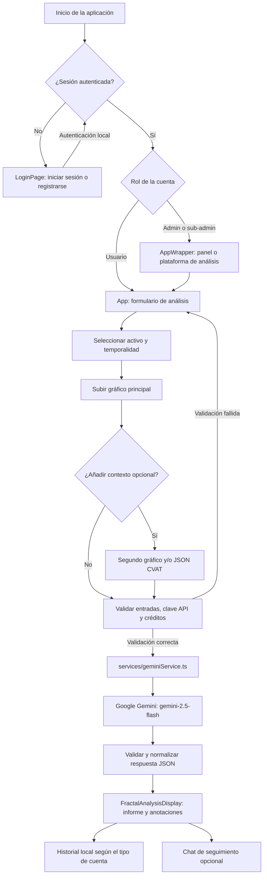

# GoldTrade AI (Beta)

GoldTrade es una aplicación web experimental para analizar capturas de gráficos financieros con Google Gemini. Permite aportar el activo y la temporalidad, añadir opcionalmente un segundo gráfico y anotaciones JSON de CVAT, y consultar patrones, niveles y zonas visuales estimadas. Incluye interfaz en español e inglés, cuentas y roles de demostración, panel administrativo, noticias y chat de seguimiento.

> **Aviso:** este proyecto es un prototipo educativo. Los resultados generados por IA pueden ser inexactos y no constituyen asesoramiento financiero ni una recomendación para operar.

## Funcionalidades

- Análisis de gráficos con Gemini (`gemini-2.5-flash`), con opción de contexto de otra temporalidad y anotaciones CVAT.
- Resultados con patrones identificados, decisión, razonamiento, confianza, niveles y anotaciones dibujadas sobre la imagen.
- Chat de seguimiento sobre el análisis y opciones para copiar o descargar la señal.
- Inicio de sesión, registro, perfil, créditos, referidos y roles de usuario, subadministrador y administrador.
- Panel de administración para usuarios, noticias y copias CSV.
- Interfaz bilingüe (español e inglés).

## Requisitos

- Node.js y npm.
- Una clave de API de Google Gemini para ejecutar el análisis.

## Ejecución local

1. Clona el repositorio y entra en su directorio.
2. Instala las dependencias:

   ```bash
   npm install
   ```

3. Crea `.env.local` en la raíz y configura tu clave:

   ```dotenv
   GEMINI_API_KEY=tu_clave_de_gemini
   ```

4. Inicia el servidor de desarrollo:

   ```bash
   npm run dev
   ```

   Vite mostrará la dirección local en la terminal.

### Compilar y previsualizar

```bash
npm run build
npm run preview
```

`npm run preview` sirve localmente la compilación ya generada. Los scripts disponibles son `dev`, `build` y `preview`; el proyecto no define actualmente un script de pruebas.

## Flujo de la aplicación



## Organización del código

```text
.
├── App.tsx                    # Formulario, análisis, historial y resultados
├── AppWrapper.tsx             # Acceso, navegación por rol y modales globales
├── index.tsx                  # Montaje React y proveedores de contexto
├── components/                # Interfaz: autenticación, análisis, administración y UI
│   └── icons/                 # Iconos SVG reutilizables
├── contexts/                  # Estado de autenticación y selección de idioma
├── hooks/                     # Hooks compartidos, incluido useTranslations
├── i18n/                      # Traducciones y tipos en inglés y español
├── services/                  # Integración con Google Gemini
├── constants.ts               # Modelo, activos, temporalidades y prompt de análisis
├── types.ts                   # Tipos de dominio y validadores de respuesta
├── index.html                 # Documento HTML y configuración visual de Tailwind
├── vite.config.ts             # Configuración de Vite y variables de entorno
├── package.json               # Dependencias y comandos npm
└── tsconfig.json              # Configuración de TypeScript
```

### Cómo colaboran las piezas

`index.tsx` monta React con `LanguageProvider` y `AuthProvider`. `AppWrapper.tsx` decide si mostrar `LoginPage`, la aplicación normal o la experiencia administrativa según la sesión y el rol. `App.tsx` valida los datos del formulario y llama a `analyzeImageWithGemini` en `services/geminiService.ts`; ese servicio arma la solicitud multimodal, interpreta y valida el JSON de Gemini. `FractalAnalysisDisplay.tsx` presenta el análisis y dibuja las zonas y niveles, mientras los contextos conservan estado de usuario/noticias y el historial de análisis se guarda en el almacenamiento local del navegador.

## Configuración y límites importantes

- `GEMINI_API_KEY` se lee durante la configuración de Vite (`vite.config.ts`). En el estado actual, la clave se sustituye en el bundle del cliente para que `services/geminiService.ts` pueda llamar a Gemini desde el navegador. **No uses una clave real con este diseño en un sitio público:** los visitantes pueden extraerla del código entregado al navegador. Para producción, mueve las llamadas a Gemini a un backend propio y protege la clave en el servidor.
- La autenticación, los usuarios, las noticias y los créditos se gestionan en el navegador mediante `localStorage` (`contexts/AuthContext.tsx`); no hay backend ni base de datos en este repositorio. La autenticación y el hash de contraseña actuales son de demostración, no seguros para producción.
- Al inicializar el estado local se crea una cuenta administradora predeterminada (`admin@goldtrade.com`, contraseña `123456`). Es solo una credencial de demostración: no la publiques ni la reutilices en un despliegue expuesto.
- El historial también es local al navegador. Los análisis se añaden al historial de la aplicación para cuentas admin, sub-admin, pro y enterprise; el estado guardado no es una base de datos compartida ni una copia de seguridad.
- El repositorio no incluye un script de lint, type-check o tests automatizados en `package.json`.

## Tecnologías

- React 19 y TypeScript 5.
- Vite 6 para desarrollo y compilación.
- Google GenAI SDK (`@google/genai`) y Gemini `gemini-2.5-flash`.
- Tailwind CSS cargado desde CDN en `index.html`.

## Licencia

No se encontró un archivo de licencia en el repositorio. Consulta al propietario antes de reutilizar o distribuir el proyecto.
