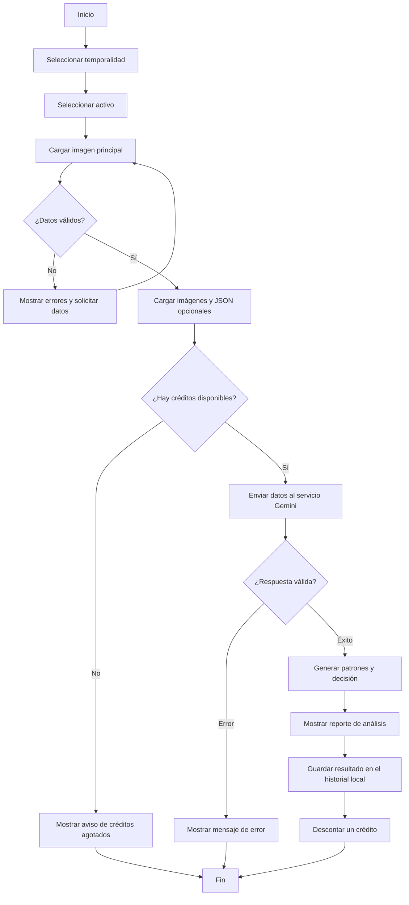

# Goltrade Beta

Goltrade Beta es una aplicación web para el análisis de patrones en gráficos financieros mediante IA. Permite cargar una imagen del gráfico principal, una imagen opcional con el resultado esperado y, opcionalmente, anotaciones exportadas desde CVAT para generar un informe de trading basado en Gemini API.

> Esta aplicación es una herramienta de apoyo basada en imágenes y resultados generados por IA. No constituye asesoría financiera ni garantiza resultados de inversión.

## Actualizaciones recientes

- Nuevo informe visual de análisis fractal con patrones, razonamiento, confianza y decisión propuesta.
- Soporte para carga de una imagen principal y una imagen opcional del resultado esperado.
- Importación de anotaciones CVAT en formato JSON, con validación de tamaño y contenido.
- Historial local de análisis disponible durante las últimas 24 horas.
- Sistema local de créditos con descuento al completar un análisis.
- Interfaz disponible en español e inglés.
- Flujo de navegación mejorado entre carga, análisis, reporte e historial.
- Gestión de estados de carga, errores y respuestas inválidas del proveedor de IA.

## Características

- Selección de temporalidad y categoría de activo.
- Carga de una imagen principal del gráfico.
- Carga opcional de una imagen con el resultado esperado.
- Importación opcional de anotaciones CVAT en formato JSON.
- Análisis mediante Gemini API.
- Informe de patrones identificados, razonamiento, confianza y decisión de trading.
- Historial local de análisis durante las últimas 24 horas.
- Interfaz disponible en español e inglés.
- Control local de créditos de análisis.

## Tecnologías

- React 19
- TypeScript
- Vite 6
- Google Gen AI SDK (`@google/genai`)
- Tailwind CSS cargado desde `index.html`

## Requisitos

- Node.js 18 o superior.
- npm.
- Una clave de API de Google Gemini.

## Instalación y configuración

1. Clona el repositorio:

```bash
git clone https://github.com/Gomezbj/goltrade-beta.git
cd goltrade-beta
```

2. Instala las dependencias:

```bash
npm install
```

3. Crea un archivo `.env.local` en la raíz del proyecto:

```env
GEMINI_API_KEY=tu_clave_de_gemini
```

4. Inicia el servidor de desarrollo:

```bash
npm run dev
```

5. Abre la URL mostrada por Vite en la terminal, normalmente `http://localhost:5173`.

## Uso

1. Selecciona la **temporalidad** del gráfico.
2. Selecciona el **activo** que deseas analizar.
3. Carga la imagen principal del gráfico. La imagen es obligatoria.
4. Opcionalmente, carga:
   - Una imagen con el resultado esperado.
   - Un archivo JSON exportado desde CVAT con las anotaciones.
5. Pulsa **Analizar**.
6. Consulta el informe en la pestaña **Reporte de análisis**.
7. Selecciona cualquier elemento del historial para volver a consultar un resultado anterior.

Los resultados permanecen en el navegador mediante `localStorage` durante un máximo de 24 horas. Los datos no se envían a un servidor propio, aunque las imágenes seleccionadas se procesan mediante Gemini API.

### Exportación desde CVAT

El campo JSON acepta un archivo con extensión o contenido JSON válido, de hasta 2 MB. El archivo puede exportarse desde CVAT y se adjunta al contexto enviado al servicio de análisis.

## Scripts disponibles

```bash
npm run dev      # Servidor de desarrollo
npm run build    # Compilación de producción
npm run preview  # Previsualización del build
```

Para comprobar la compilación:

```bash
npm run build
```

Los archivos generados se colocarán en la carpeta `dist`.

## Diagrama de flujo



## Arquitectura del proyecto

```text
.
├── App.tsx                    # Estado principal, navegación y flujo de análisis
├── components/                # Interfaz, cargadores, reportes e historial
├── contexts/                  # Contexto de idioma
├── hooks/                     # Hooks reutilizables
├── i18n/                      # Traducciones español/inglés
├── services/
│   └── geminiService.ts       # Comunicación con Gemini API
├── constants.ts               # Activos, temporalidades y configuración
├── types.ts                   # Tipos compartidos
├── package.json               # Dependencias y scripts
├── vite.config.ts             # Variables de entorno y configuración Vite
└── index.html                 # Entrada HTML y configuración visual
```

## Variables de entorno

| Variable | Requerida | Uso |
|---|---:|---|
| `GEMINI_API_KEY` | Sí | Autentica las solicitudes al servicio Gemini |

## Limitaciones

- El análisis depende de la disponibilidad y cuota de Gemini API.
- Los resultados pueden variar según la calidad y resolución de las imágenes.
- Los créditos y el historial se almacenan únicamente en `localStorage` del navegador.
- Limpiar los datos del navegador elimina el historial y restablece los créditos según la configuración local.
- Las decisiones propuestas son informativas y no deben utilizarse como única base para operar en mercados financieros.

## Contribución

1. Crea una rama para tu cambio.
2. Realiza pruebas con `npm run build`.
3. Envía un pull request con una descripción clara del cambio.
